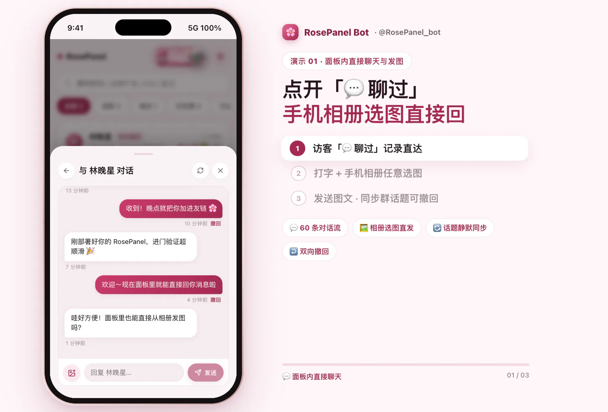
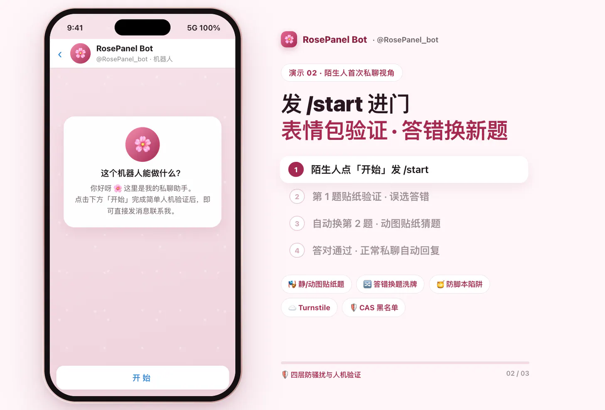
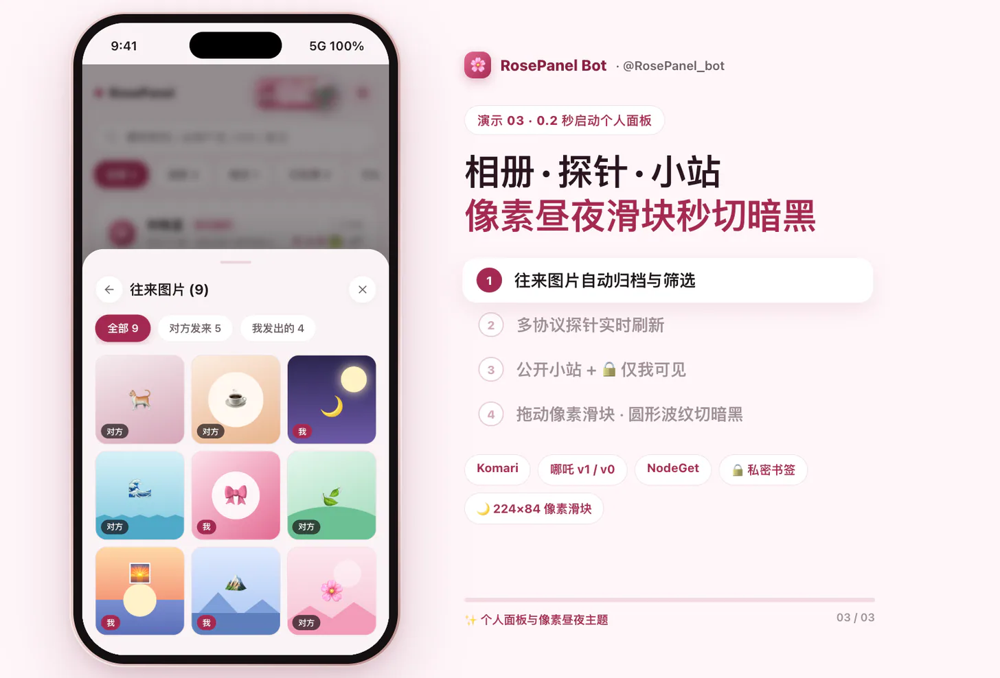
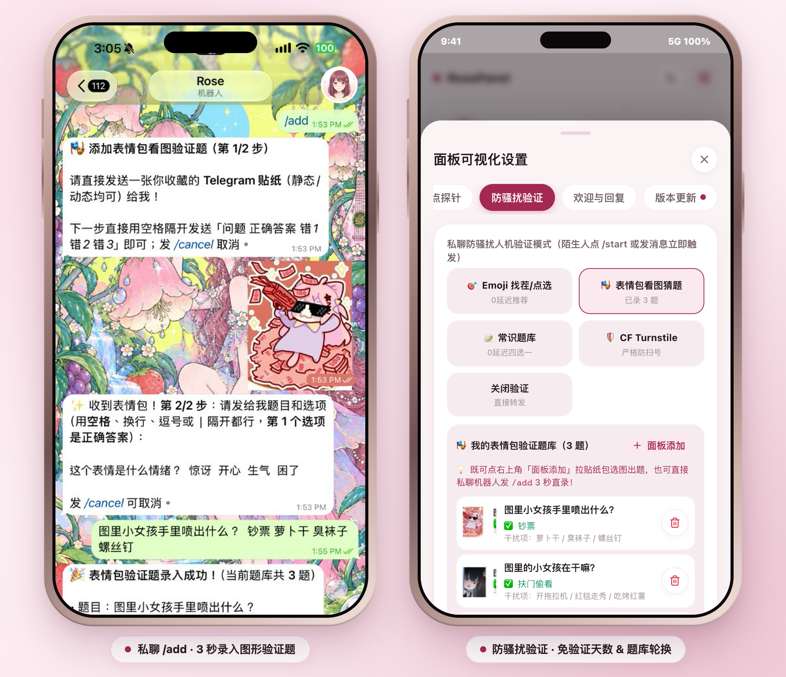
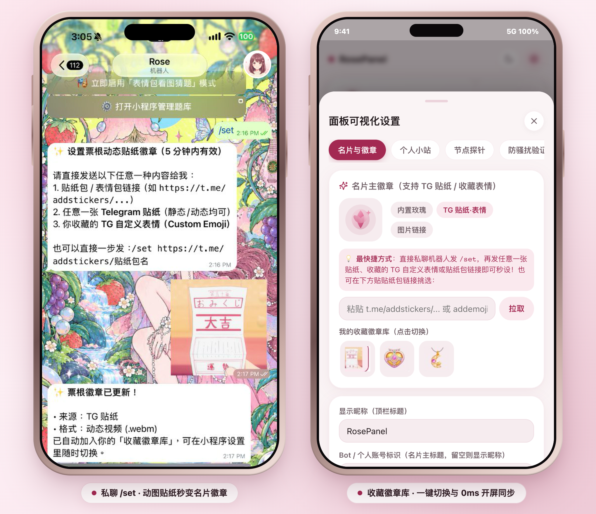
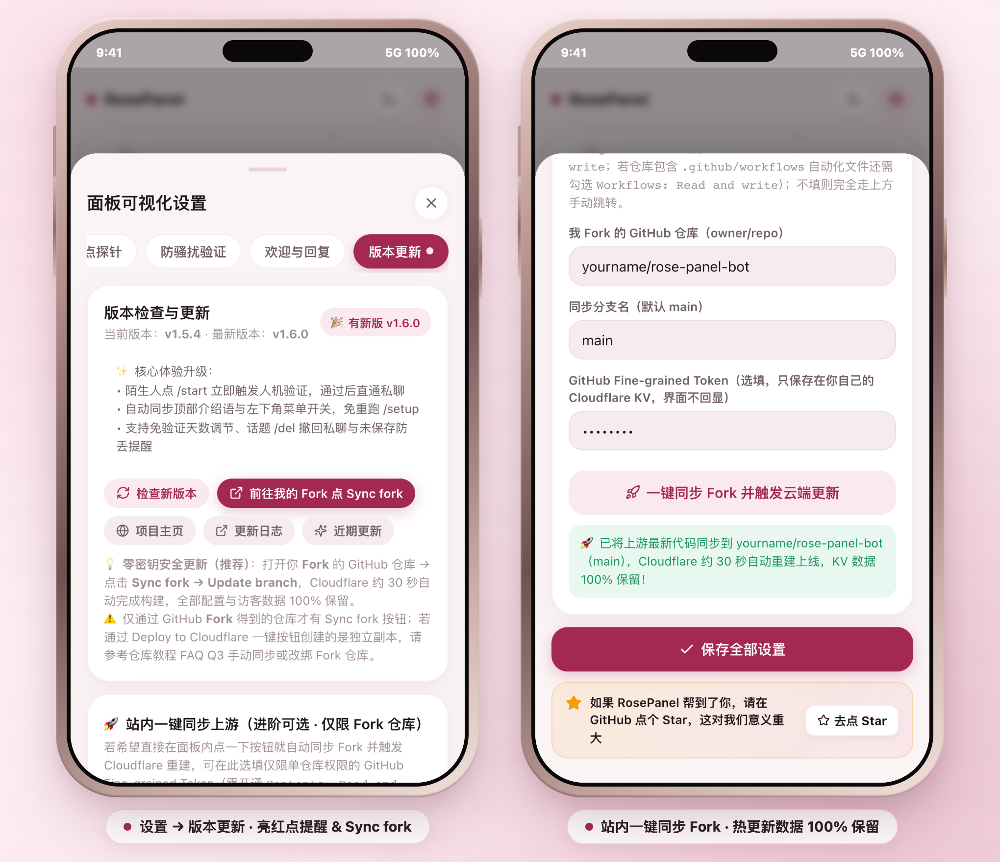
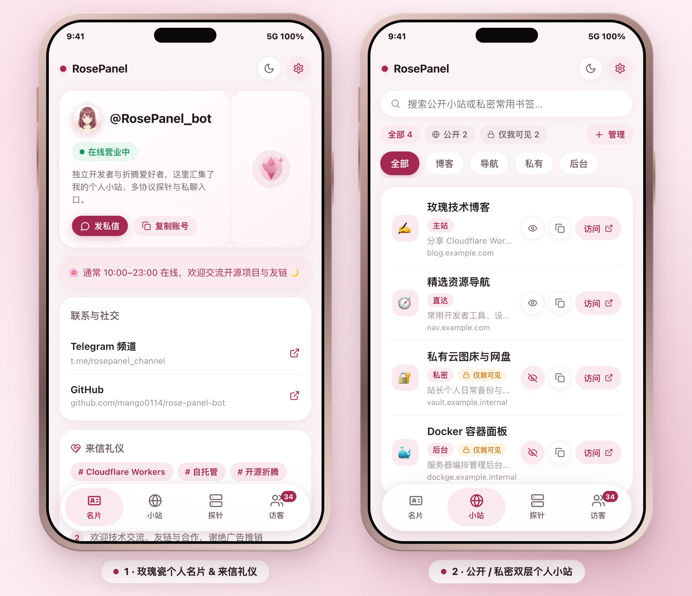
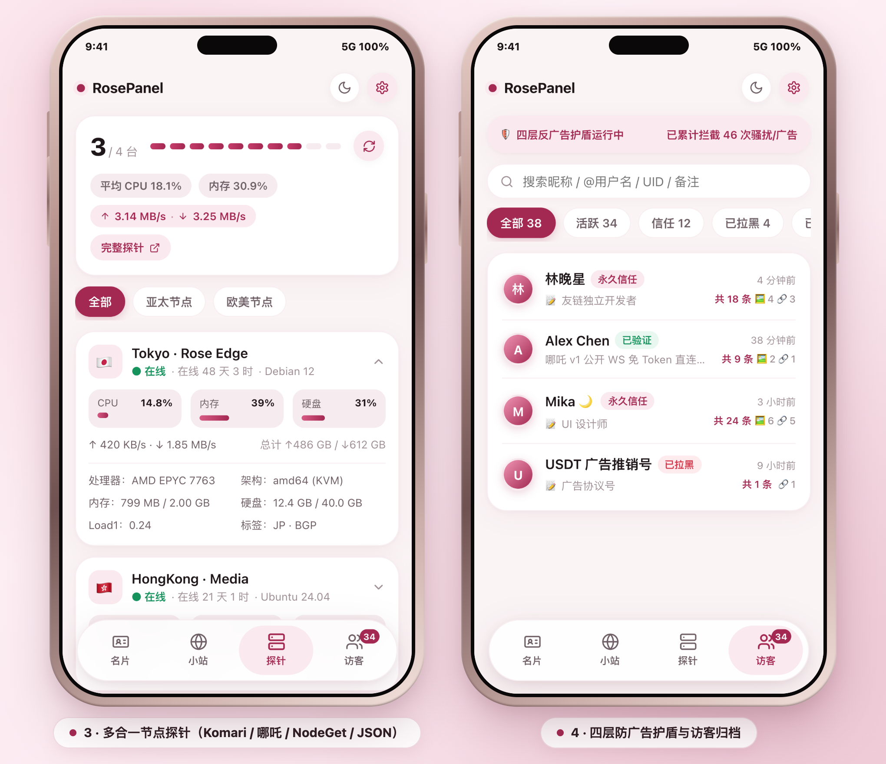
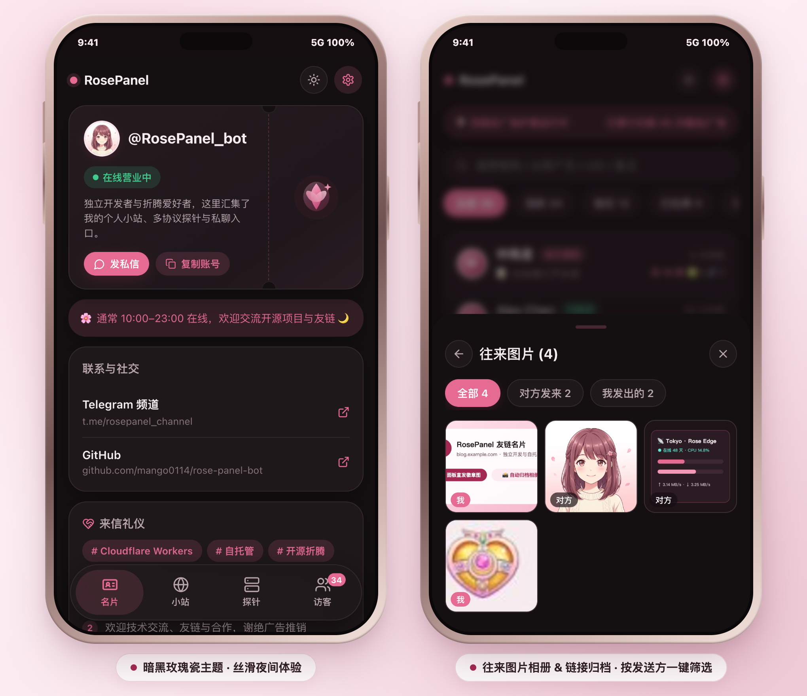
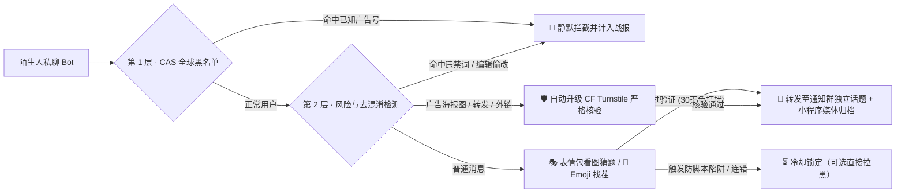

<div align="center">


<br />

[](https://github.com/mango0114/rose-panel-bot/releases)
[](https://github.com/mango0114/rose-panel-bot/stargazers)
[](https://t.me/Rose202_bot)
[](https://workers.cloudflare.com/)
[](https://core.telegram.org/bots/webapps)
[](LICENSE)

<p>
  <b>🇨🇳 简体中文</b> ·
  <a href="README_EN.md">🇺🇸 English</a> ·
  <a href="docs/SETUP_GUIDE.md">🐣 零基础 5 分钟教程</a> ·
  <a href="AGENTS.md">🤖 AI 一键部署协议</a> ·
  <a href="CHANGELOG.md">📋 更新日志</a> ·
  <a href="https://t.me/Rose202_bot">💬 在线体验 / 联系作者</a> ·
  <a href="#-赞助与支持">🧧 赞助支持</a>
</p>

<p>
  <a href="https://deploy.workers.cloudflare.com/?url=https://github.com/mango0114/rose-panel-bot">
    
  </a>
</p>

<sub><b>在面板里直接聊天、发图的防广告 Telegram 私聊机器人</b> — 面板内看记录、打字/发图回复与撤回 · 四层防护 + 4 种人机验证（含动图题）· 免会员自定义回复 · 附带 <b>0.2 秒启动个人面板</b>（多协议探针模块 / 网站书签），Cloudflare Workers 免费部署</sub>

</div>

> **🔒 零数据收集承诺**：本项目 **不收集任何用户数据、不经过作者或任何第三方中转服务器**；所有 Bot Token、配置、小站与访客记录全部保存在**你自己的 Cloudflare Workers 与 KV** 中，代码 100% 开源可审计（除 Telegram 官方 Bot API 外，仅在对应功能开启时请求公开只读的 CAS 黑名单、CF Turnstile 校验，以及站长打开设置时向 GitHub 公开接口检查新版本）。

> **🧭 快速上手分流（老手 / 小白各走各的，不绕路！）**：
> - **⚡ 老手（已有 TG 机器人 Token + Cloudflare 账号）**：直接点上方 **Deploy to Cloudflare**，或把仓库丢给 AI（准备好 `BOT_TOKEN`，等 AI 问你要时贴给它）→ **[查看 1 分钟老手速通](docs/SETUP_GUIDE.md#-老手速通通道已有-bot-token--cloudflare)**
> - **🐣 小白（还没有机器人 或 还没有 Cloudflare 账号）**：AI 没法替你申请机器人，先花 30 秒去 TG 找 `@BotFather` 拿到 Token → **[零基础 5 分钟保姆教程（含全景流程图）](docs/SETUP_GUIDE.md#-小白零基础通道还没有机器人或-cloudflare)**
> - **🤖 AI 懒人部署提示词**（支持 Antigravity / Claude Code / Codex / Cursor，内置 [AGENTS.md](AGENTS.md)）：
>   ```text
>   请阅读仓库里的 AGENTS.md，先询问我需要开启哪些模块（或选择轻量化安装），再帮我一步步部署 RosePanel Bot。
>   ```

---

## ✨ 5 秒看懂 RosePanel 的 5 个特色

| 核心特色 | 一句话看懂 |
| :--- | :--- |
| **💬 面板内直接聊天发图** | 点「💬 聊过」看 60 条记录，直接打字 / 手机相册发图 / 双向撤回，静默同步管理群话题 |
| **🎭 收藏动图出验证题** | 私聊 `/add` 3 秒用静/动图出题，**答错换题洗牌** + 防脚本蜜罐 + CAS 黑名单联防 |
| **🎨 0.2 秒面板 + 像素滑块** | 原创 **224×84 像素昼夜气泡滑块**（圆形波纹切暗黑）+ `/set` 动态贴纸徽章 + 隐私头像代理 |
| **📡 模块化按需选配** | Komari / 哪吒（v1·v0）/ NodeGet / JSON 探针 + 公开/私密双层小站，不装零负担 |
| **🔒 零中转 + Fork 一键更新** | 运行在你自己的 Cloudflare Workers 免费额度；新版站内提醒，Fork 一键同步且数据 100% 保留 |

---

## 🎬 动态功能演示（三段实机录屏）

### 1 · 面板内直接聊天与相册选图发图

<div align="center">
  
</div>

- 点开任意访客资料卡的 **「💬 聊过」** 即可查看最近 60 条双向对话气泡，**直接在小程序内打字、从手机相册任意选图（JPG / PNG / WebP / GIF，单张 ≤ 10 MB）发送，并支持一键双向撤回**；
- 发出的图文会自动静默抄送至管理群对应话题，两边随时无缝接力，往来图片与链接按「对方发来 / 我发出的」自动分类归档。

### 2 · 陌生人首次 `/start` 表情包双题验证（答错自动换新题）

<div align="center">
  
</div>

- 陌生人点「开始」发 `/start` 立即触发人机验证：私聊发 `/add` 三秒即可用你收藏的**静态 / 动态贴纸**出专属趣味看图题；
- **答错就洗牌**：题库有多道题时立刻换另一张贴纸出题（单题则重新随机打乱按钮位置），题底附带防脚本蜜罐陷阱；通过后 30 天内免验证直通私聊，并可触发**免会员自动回复与关键词秒回**。

### 3 · 0.2 秒启动个人面板 & 224×84 像素昼夜气泡滑块

<div align="center">
  
</div>

- 往来图片相册支持按发送方一键筛选；内置 **Komari / 哪吒（v1 / v0）/ NodeGet / 通用 JSON** 多协议可插拔探针与 **公开 / 🔒 仅我可见** 双层个人小站；
- **全新 224×84 像素昼夜气泡滑块**：顶栏水晶放大镜滑块可自由拖动切换 **浅色 / 跟随 Telegram / 暗黑玫瑰瓷**，松手以圆形波纹平滑切换全屏深浅主题，并同步 Telegram 原生顶栏配色。

---

## 💬 更多主打亮点：`/add` 出题 · `/set` 动态徽章 · Fork 一键同步更新

<div align="center">
  <p><b>🎭 私聊 <code>/add</code> 三秒录入贴纸验证题 · 陌生人点 Start 即验直通私聊</b></p>
  
  <br /><br />
  <p><b>✨ 私聊 <code>/set</code> 秒换动态贴纸主徽章 · 收藏徽章库与 0 秒开屏同步</b></p>
  
  <br /><br />
  <p><b>🔄 Fork 部署 · 新版站内提醒 · 一键同步更新（数据 100% 保留）</b></p>
  
</div>

<details>
<summary><b>📱 展开查看四大菜单静态超清实机画廊（名片 · 小站 · 探针 · 暗黑主题）</b></summary>

<br />
<div align="center">
  <p><b>🪪 1 · 玫瑰瓷个人名片与一键发私信　｜　🌐 2 · 公开 / 私密双层个人小站</b></p>
  
  <br /><br />
  <p><b>📡 3 · 多合一节点探针（Komari / 哪吒 / NodeGet / JSON）　｜　🛡️ 4 · 四层防广告护盾与访客列表</b></p>
  
  <br /><br />
  <p><b>🌙 暗黑玫瑰瓷主题　｜　🖼️ 往来图片相册与链接清单（按「对方发来 / 我发出的」自动归档）</b></p>
  
</div>
</details>

---

## ✨ 核心功能一览

- **💬 面板内直接打字 / 发图聊天 + 往来图片与链接归档 + 群内 `/bind` 收件箱**
  - **小程序内直接聊天**：点开任意访客资料卡的 **「💬 聊过」** 即可查看最近 60 条双向对话气泡，支持**直接在面板内打字、从相册选图发送、一键撤回消息**，所有回复会自动静默抄送至通知群对应话题，两边随时无缝接力；
  - **往来媒体自动归档 & 一键绑群**：双方发送的图片（HMAC 签名私密代理 + 灯箱）与网址链接自动按「对方发来 / 我发出的」分类归档；私密话题群发一句 **`/bind`** 即可完成绑定（免查 `-100...` 群 ID），支持话题内 `/del` 撤回私聊、备注、拉黑/一键解封/永久信任与清空记录。
- **🎭 一键发送静 / 动态贴纸，快捷设置图形验证题**
  - 私聊机器人发 `/add` 再直接丢一张你收藏的静态/动态贴纸 + 空格输入选项，3 秒生成专属看图选择题；也支持在小程序内拉取贴纸包直接点选出题，真人一眼秒过，大幅提高自动化广告脚本的绕过成本。
- **🛡️ 四层智能防广告护盾（毫秒级零卡顿）**
  1. **第 1 层 · CAS 全球反垃圾黑名单联防**：陌生人首次联系查询公开 CAS 库（KV 缓存），**真人 0 感知秒过**，已知广告协议号直接静默拦截；
  2. **第 2 层 · 拦截广告海报图 + 高危自动升级**：未验证前直接甩 USDT/赌场/机场纯图海报、频道转发或外链时拒收暂存，并自动升级至 Cloudflare Turnstile 严格核验；
  3. **第 3 层 · 0 延迟图形/Emoji 验证 + 防脚本蜜罐**：支持贴纸看图验证、Emoji 找茬、常识题库与 CF Turnstile 四档切换；题底可埋设防脚本陷阱按钮（默认触发验证冷却防真人误触永久失联，亦可切为直接拉黑），连错自动进入冷却；
  4. **第 4 层 · 去混淆关键词屏蔽 + 编辑偷改监听**：自动去除零宽/全角/西里尔同形字混淆，并监听 `edited_message` 拦截「先发正常话、几秒后偷改成广告」的绕过。
- **⚡ 附送 0.2 秒启动个人面板小程序、像素昼夜滑块 & 动态贴纸徽章**
  - Worker 边缘 HTML 注入开屏配置（支持 **徽章呼吸 / 表情跳动 / 卡片骨架屏** 3 种风格）+ 前端本地秒开缓存 + 站长概览单键缓存（KV 消耗降 50 倍）；顶栏内置原创 **224×84 像素昼夜气泡滑块**（浅色 / 跟随 Telegram / 暗黑玫瑰瓷三档自由拖动 + 圆形波纹切换），并同步 Telegram 原生顶栏配色；
  - 私聊发 `/set` 直接发静态 `.webp` / 动态视频 `.webm` / 60fps 矢量 `.tgs` 贴纸或自定义表情，秒换名片主徽章并自动存入收藏徽章库；名片头像支持 **🤖 机器人头像（默认隐藏主号）/ 👤 站长 TG 头像隐匿代理 / 🖼️ 自定义直链** 3 选 1，右侧票根文案支持自由编辑与留空隐藏；
  - 站长首屏底部附带 **仅自己可见的「站长速览」**（已拦截广告数、活跃访客数、最近联系快捷直达），升级新版自动弹出 **「✨ 近期更新」** 变更摘要，内置 **「版本更新」检查新版本与一键同步 Fork 并触发云端更新**，并支持一键开启 **群签到积分与徽章系统**。
- **🌐 公开 / 私密双层个人小站 & 📡 多协议节点探针（按需安装）**
  - 小站支持分类、搜索、排序与单条一键切换 **「公开 / 🔒 仅我可见」**（私密站点服务端严格剔除，访客不可见）；
  - 探针采用可插拔架构，内置 **Komari (v2/v1)**、**哪吒探针 (v1 公开 WS / v1 REST / v0)**、**NodeGet (NodeSeek 官方探针)** 与 **通用 JSON 探针**（极简/CF/ServerStatus 等），内置「测试探针连接」、重定向循环保护、15 秒边缘缓存与 **「仅自己可见」** 隐私开关，不点进探针 Tab 零额外请求。
- **🤖 丝滑进门引导、免会员自动回复 & 关键词秒回**
  - **进门即验 · 直通私聊**：保存欢迎语自动同步至 Telegram 未点开始前的顶部介绍框；陌生人点 `/start`（或在名片点「发私信」）直接弹出人机验证，通过后即可直接打字留言；支持自由调节免验证天数（1–3650 天）与一键显隐左下角「个人面板」菜单按钮（免重跑 `/setup`）；
  - **收到消息自动回复 & 关键词秒回（最多 50 条）**：自定义忙碌回执 + 单访客冷却防刷屏；关键词支持包含/精确匹配与「转发站长 / 静默直回」，严格在验证通过后触发。

---

## 🛡️ 四层防骚扰与人机验证架构



内置 **4 种人机验证方式**，可在小程序 **⚙️ 设置 → 防骚扰验证** 一键切换：

| 验证模式 | 原理与体验 | 防刷与防绕过 |
| :--- | :--- | :--- |
| **🎭 表情包看图猜题（私房推荐）** | 私聊发 `/add`（或在小程序贴纸包内点选）录入你收藏的动图/静图表情包与自定义趣味选项，**真人一眼秒过、大幅提高自动化协议号绕过成本** | 答错就洗牌：题库有多道题时换另一张贴纸出题，只有一道题时正确答案与干扰项重新打乱顺序；通过后自动清理贴纸 + 蜜罐陷阱与静默冷却 |
| **🎯 Emoji 找茬 / 点选（默认）** | 3×3 纯图标按钮随机交替出题（8 同 1 异找茬或中文提示点选），**0 延迟、真人 0.5 秒通过** | 错 1 次立刻换题打乱，连错 2 次静默冷却 10 分钟（次数与时长可调） |
| **📝 常识题库** | 本地 2×2 常识问答按钮，零外部依赖 | 错 1 次换题并重新打乱选项 + 蜜罐 + 静默冷却 |
| **🛡️ CF Turnstile 严格模式** | 遇到定向扫号攻击时一键开启，在 Telegram 内嵌 WebApp 完成 Cloudflare 服务端 `siteverify` 核验 | 未配密钥时自动回退至 Emoji 模式防卡死 |

- **🔀 答错就洗牌（防背答案）**：三种按钮验证（表情包看图猜题 / Emoji 找茬 / 常识题库）答错一次就立刻换新题，正确答案与干扰项每次都重新打乱顺序。**哪怕抽到的还是同一道题，正确答案的按钮位置也会重新随机**，脚本无法靠「记住第几个按钮」稳定蒙混过关；连错达到上限（默认 2 次）即静默冷却。

- **数据与权限安全**：Mini App 接口全量校验 Telegram 官方 `initData` HMAC-SHA256 签名；站长概览采用单键缓存与内存 `<0.1ms` 极速鉴权，日常打开仅需 2 次 KV 读取、0 次 `KV.list`；`BOT_TOKEN` 绝不暴露前端。

---

## 🧩 模块化按需选配 & 🤖 AI 引导安装

未启用的模块零负担、不干扰界面；仓库根目录内置标准 **[AGENTS.md](AGENTS.md)**，用 AI 编程助手安装时 AI 会先询问你需要哪些模块：

| 模块 | 默认状态 | 开启条件 | 说明 |
| :--- | :---: | :--- | :--- |
| **🪪 个人名片 + 🌐 公开/私密小站** | 核心必选 | `BOT_TOKEN` + `TOPIC_MAP` KV | 极简运行即可拥有玫瑰瓷个人面板、动态贴纸徽章与双层小站 |
| **📡 多协议节点探针** | 按需选配 | 小程序内选择类型并填地址 | 支持 **Komari / 哪吒 (v1/v0) / NodeGet / 通用 JSON**，未填或设为「仅自己可见」时对访客隐藏 |
| **👤 双向私聊 + 四层反广告护盾** | 按需选配 | 话题群内发 `/bind`（或填 `SUPERGROUP_ID`） | 话题收件箱、往来图片相册、链接归档、CAS 与表情包验证 |
| **🛡️ CF Turnstile 严格验证** | 按需选配 | 填入 `TURNSTILE_SITE_KEY` & `SECRET` | 高危广告自动升级核验，或在设置里手动切换 |
| **🌸 群签到积分与徽章系统** | 按需选配 | `ENABLE_CHECKIN="true"` 或设置内一键开 | 个人名片模式默认关闭，群社区部署时一键开启 |

> **🤖 AI 一键选配部署（Antigravity / Claude Code / Codex / Cursor 通用）**：打开本仓库对 AI 说：
> ```text
> 请阅读仓库里的 AGENTS.md，先询问我需要开启哪些模块（或选择轻量化安装），再帮我一步步部署 RosePanel Bot。
> ```

---

## 🚀 极简部署（5 分钟免费上线）

> **🐣 第一次申请 Telegram 机器人？** 请直接跟着 **[零基础 5 分钟保姆教程](docs/SETUP_GUIDE.md)** 一步步操作，从 `@BotFather` 拿到第一个 Token 到群内 `/bind` 上线零门槛！

### 方式一：网页零环境部署（最省心 ★，免装本地环境）

1. **推荐先点击右上角 Fork** 再到 Cloudflare Dashboard → **Workers & Pages → Create → Workers → Import a repository** 选择你 Fork 的 `rose-panel-bot`（以后永久支持 `Sync fork` 与小程序站内一键更新）；也可直接点顶部 **Deploy to Cloudflare** 按钮快速尝鲜：
   - **Build command**：`npm run build`
   - **Deploy command**：`npx wrangler deploy`
2. 在 Worker 的 **Settings → Variables & Bindings** 确认绑定了 `TOPIC_MAP` KV，并填入 4 个核心变量：`BOT_TOKEN`（Secret）、`WEBHOOK_SECRET`（Secret）、`ADMIN_IDS`（**务必选 Text 变量文本**，填你的纯数字 UID；若一键部署默认建成了 Secret 密钥请删掉重加为 Text）、`BOT_USERNAME`（不含 `@`）。
3. 浏览器访问一次 `https://<你的域名>/setup?secret=<WEBHOOK_SECRET>` 看到 `"ok": true`。
4. *(如需双向私聊)* 新建开启 **「话题 (Topics)」** 的私密群、把机器人设为管理员，在群里发一句 **`/bind`** 即可完成全部配置！

### 方式二：开发者终端 4 步速通（macOS / Linux / Windows，全程不点网页）

```bash
# 1. 拉取代码并安装依赖（需 Node.js 20+）
git clone https://github.com/mango0114/rose-panel-bot.git && cd rose-panel-bot && npm ci

# 2. 登录 Cloudflare 并构建部署（Wrangler v4 会自动创建 TOPIC_MAP KV）
#    把下方替换为你的纯数字 TG UID 和机器人用户名（不含 @）
npx wrangler login
npm run build && npx wrangler deploy --var ADMIN_IDS:你的数字UID --var BOT_USERNAME:你的Bot用户名

# 3. 写入两个核心 Secret（按提示粘贴即可）
npx wrangler secret put BOT_TOKEN
npx wrangler secret put WEBHOOK_SECRET

# 4. 激活 Webhook 与菜单（看到 {"ok":true,...} 即上线）
curl -s "https://<你的Worker域名>/setup?secret=<你的WEBHOOK_SECRET>"
```

> *(如需双向私聊)* 新建开启 **「话题 (Topics)」** 的私密群、把机器人设为管理员，群内发一句 **`/bind`** 即可完成绑定。

<details>
<summary><b>🛠️ 环境安装（Windows / macOS）与 Linux VPS / Docker / 纯自托管</b></summary>

- **Windows 安装 Git & Node**：`winget install --id Git.Git -e && winget install --id OpenJS.NodeJS.LTS -e`
- **macOS 安装 Git & Node**：`brew install git node`
- **Linux 安装 Git & Node 22**：
  - Debian / Ubuntu：`sudo apt update && sudo apt install -y curl git ca-certificates && curl -fsSL https://deb.nodesource.com/setup_22.x | sudo -E bash - && sudo apt install -y nodejs`
  - CentOS / Rocky / Alma：`sudo dnf install -y curl git && curl -fsSL https://rpm.nodesource.com/setup_22.x | sudo bash - && sudo dnf install -y nodejs`
  - Arch：`sudo pacman -Syu --noconfirm git nodejs npm` ｜ Alpine：`apk add --no-cache git nodejs npm`

#### 无浏览器 VPS 推送到 Cloudflare Workers
```bash
git clone https://github.com/mango0114/rose-panel-bot.git && cd rose-panel-bot && npm ci
export CLOUDFLARE_API_TOKEN="你的_Cloudflare_API_Token"
npm run build && npx wrangler deploy --var ADMIN_IDS:你的数字UID --var BOT_USERNAME:你的Bot用户名
echo "你的_BOT_TOKEN" | npx wrangler secret put BOT_TOKEN
echo "你的随机_WEBHOOK_SECRET" | npx wrangler secret put WEBHOOK_SECRET
curl -s "https://<你的Worker域名>/setup?secret=<你的WEBHOOK_SECRET>"
```

#### Docker 一行部署（不污染宿主机）
```bash
git clone https://github.com/mango0114/rose-panel-bot.git && cd rose-panel-bot
docker run --rm -it -v "$PWD":/app -w /app -e CLOUDFLARE_API_TOKEN="你的_API_Token" node:22-alpine \
  sh -c "npm ci && npm run build && npx wrangler deploy --var ADMIN_IDS:你的数字UID --var BOT_USERNAME:你的Bot用户名"
```

#### 纯 VPS 自托管（配合 Caddy 自动 HTTPS）
```bash
npm ci && npm run build && cp .dev.vars.example .dev.vars
# 编辑 .dev.vars 填入真实变量（DEV_PREVIEW 仅在 localhost 生效，生产保持 "false"）
npx wrangler dev --ip 127.0.0.1 --port 8787 --persist-to ./.wrangler/state --show-interactive-dev-session=false
```
再用 Caddy 反向代理 `reverse_proxy 127.0.0.1:8787` 绑定 HTTPS 域名即可。
</details>

---

## 🔄 老用户如何升级到最新版（100% 保留 KV 数据）

> **✅ 无需修改 Cloudflare KV！** 升级只更新代码，你原有的名片、小站、探针、访客记录与通知群绑定都会 **100% 原样保留**（⚠️ 请勿重新点击「Deploy to Cloudflare」按钮，那会新建一个空的 Worker 和 KV）。

- **🔀 方式 A · GitHub Fork 用户（最简单）**  
  到你的 GitHub Fork 仓库点击 **`Sync fork → Update branch`**（升至 `v1.4.0+` 后也可在小程序 **⚙️ 设置 → 版本更新** 内一键同步），Cloudflare 约 30 秒自动完成重建上线。
- **🤖 方式 B · 直接交给 AI 一键更新（适合一键按钮独立副本 / AI 部署用户）**  
  把下面这段话发给你的 AI 助手（Antigravity / Claude Code / Codex / Cursor 等）：
  ```text
  请阅读 https://github.com/mango0114/rose-panel-bot 的 AGENTS.md，帮我把之前部署的 RosePanel Bot 升级到最新版：把上游最新代码合并进我自己的 GitHub 仓库并推送，让 Cloudflare 自动重建。不要新建 Worker、KV 或 Bot；如果必须用 wrangler 部署，先确认 Worker 名称和 wrangler.toml 里的 KV ID 与我原来的一致并用 --keep-vars。
  ```
- **💻 方式 C · 本地 CLI 部署用户**  
  在项目目录执行：`git pull && npm install && npm run build && npx wrangler deploy --keep-vars`。

---

## ⚙️ 环境变量一览

| 变量名 | 类型 | 必填 | 说明 |
| :--- | :--- | :---: | :--- |
| `TOPIC_MAP` | KV Binding | ✅ | 持久化面板配置、小站、访客与媒体归档、签到数据 |
| `BOT_TOKEN` | Secret | ✅ | `@BotFather` 颁发的 Telegram Bot Token |
| `ADMIN_IDS` | Text | ✅ | 站长数字 UID，多个用英文逗号分隔（配置后 `<0.1ms` 内存极速鉴权，0 KV 写入） |
| `WEBHOOK_SECRET` | Secret | ✅ | 随机密钥，保护 Webhook（含 `/` 与 `/webhook`）与 `/setup`（未配置时 `/setup` 拒绝执行） |
| `BOT_USERNAME` | Text | 推荐 | 机器人用户名（不含 `@`） |
| `APP_SHORT_NAME` | Text | 推荐 | BotFather `/newapp` 设置的小程序短名（如 `panel`） |
| `SUPERGROUP_ID` | Text | 可选 | 话题通知群 ID（**推荐部署后直接在群内发 `/bind` 一键绑定，免手填**） |
| `TURNSTILE_SITE_KEY` / `TURNSTILE_SECRET` | Text / Secret | 可选 | 开启 CF Turnstile 严格验证模式时填写 |
| `PROBE_PROVIDER` | Text | 可选 | 探针类型：`komari`（默认）/ `nezha` / `nodeget` / `json`（极简、CF 等通用 JSON 探针） |
| `PROBE_URL` / `PROBE_API_KEY` | Text / Secret | 可选 | 探针地址与私有凭证（旧名 `KOMARI_URL` / `KOMARI_API_KEY` 仍兼容，也可在小程序内填写并一键测试连接） |

---

## 🤖 常用指令

- **通用**：`/start` · `/panel` · `/me` · `/checkin`（群社区模式）· `/rank`（群社区模式）
- **站长私聊**：`/set`（秒设动态贴纸主徽章）· `/add`（录入收藏表情包看图验证题）· `/resetbadge` · `/cancel`
- **通知群话题内**：`/bind`（一键绑定通知群）· `/unbind`（解绑）· `/del`（回复消息撤回私聊）· `/info` · `/ban` · `/unban` · `/trust` · `/reset` · `/close` · `/open`

---

## 🙏 致谢与技术栈

- 协议适配与兼容：[Komari Monitor](https://github.com/komari-monitor/komari) · [Combot Anti-Spam (CAS)](https://cas.chat/) · [jikssha/telegram_private_chatbot](https://github.com/jikssha/telegram_private_chatbot)
- 开源基础设施：[Cloudflare Workers](https://workers.cloudflare.com/) · [Telegram Mini Apps](https://core.telegram.org/bots/webapps) · [React](https://react.dev/) · [Vite](https://vitejs.dev/) · [Lucide Icons](https://lucide.dev/) · [lottie-web](https://github.com/airbnb/lottie-web)

---

## 🧧 赞助与支持

本项目以 MIT 协议完全免费开源，所有核心功能零付费墙、零数据收集。如果你喜欢 **RosePanel Bot**，或者它帮你挡掉了恼人的 TG 广告骚扰，欢迎请作者喝杯咖啡 / 投喂一点 AI 算力，支持项目持续迭代更强的功能 ☕✨

- **在线体验 & 联系作者**：👉 **[@Rose202_bot](https://t.me/Rose202_bot)**（可亲手体验 0.2 秒启动个人面板与表情包看图验证）
- **支付宝口令红包赞助（保护双方隐私）**：
  1. 在支付宝生成一个任意金额的 **「口令红包」**；
  2. 私聊 **[@Rose202_bot](https://t.me/Rose202_bot)** 通过验证后，发送 **口令 + 你想展示在名单中的昵称与留言**（支持匿名）；
  3. 收到后会第一时间将你的支持记录到下方赞助者名单中！

### 🏆 赞助者名单

感谢以下支持者的慷慨赞助，您的支持是我们持续改进的动力！

<details open>
<summary><b>展开查看完整赞助者名单（虚位以待 🌸）</b></summary>

| 序号 | 赞助者 | 金额 | 留言 |
| :---: | :---: | :---: | :--- |
| 1 | *虚位以待* | — | 成为第一位支持者，点亮开源赞助墙 ✨ |

</details>

---

## 🌟 Star History

<a href="https://www.star-history.com/#mango0114/rose-panel-bot&Date">
 <picture>
   <source media="(prefers-color-scheme: dark)" srcset="https://api.star-history.com/svg?repos=mango0114/rose-panel-bot&type=Date&theme=dark" />
   <source media="(prefers-color-scheme: light)" srcset="https://api.star-history.com/svg?repos=mango0114/rose-panel-bot&type=Date" />
   
 </picture>
</a>

---

<div align="center">
  <br />
  <b>⭐ 如果这个项目对您有帮助，请给个 Star 支持一下！</b><br /><br />
  <sub>MIT License © 2026 <a href="https://github.com/mango0114">mango0114</a></sub>
</div>
